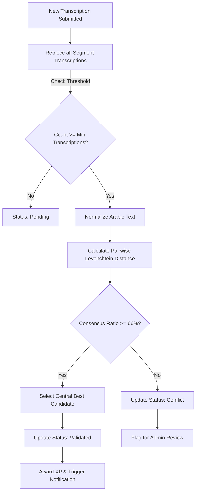

# Khatt-GPT Platform

A collaborative web application designed for crowdsourcing, annotating, curating, and validating historical Arabic manuscript transcriptions. 

The platform features an automated quality-control pipeline (consensus engine), user roles, gamification hooks, and real-time database notifications to streamline dataset creation for HTR/OCR research.

---

## 🚀 Key Features

* **Data Quality & Consensus Engine:**
  * Implemented an algorithmic consensus verifier ([consensus.ts](file:///J:/UnivHm_NextJS/site-collaboratif-dataset/src/lib/consensus.ts)) to enforce transcription quality.
  * Cleans and normalizes Arabic orthography (standardizing spaces, letter forms of Alef, and stripping decorative tatweel).
  * Computes pairwise text similarity using **Levenshtein Distance**.
  * Automatically validates transcriptions that cross a similarity threshold (>85%) and flags disagreements as "conflicts" for expert/admin resolution.
* **Relational Database Design:**
  * Powered by `PostgreSQL` and `Supabase` backend.
  * Structured schema to track users, badges, document segments, transcription submissions, consensus scores, and notifications.
  * Enforced Row-Level Security (RLS) policies to isolate admin actions from contributor actions.
* **Gamification & Curation UI:**
  * Interactive dashboards for annotators to transcribe manuscript line segments.
  * Real-time user stats, XP, achievement badges, and reward triggers to incentivize crowdsourced participation.

---

## 🛠️ Data Quality Workflow (Consensus Engine)



---

## 💻 Tech Stack

* **Frontend:** Next.js (App Router), TypeScript, Tailwind CSS, Shadcn UI, Lucide React.
* **Backend & Database:** Supabase (PostgreSQL), Next.js API Routes, Database RLS policies.
* **Development Tools:** ESLint, Turborepo, npm workspaces.

---

## ⚙️ Setup & Installation

1. **Clone the repository:**
   ```bash
   git clone https://github.com/h-yassin-ai/Khatt-GPT.git
   cd Khatt-GPT
   ```

2. **Install dependencies:**
   ```bash
   npm install
   ```

3. **Configure Environment Variables:**
   Create a `.env.local` file at the root:
   ```env
   NEXT_PUBLIC_SUPABASE_URL=your_supabase_project_url
   NEXT_PUBLIC_SUPABASE_ANON_KEY=your_supabase_anon_key
   SUPABASE_SERVICE_ROLE_KEY=your_supabase_service_role_key
   ```

4. **Start local development server:**
   ```bash
   npm run dev
   ```
