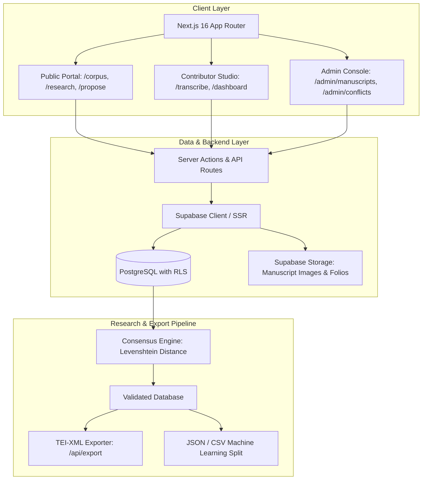

# Khatt-GPT — Collaborative Arabic Manuscript Transcription Platform

[](https://khattgpt.vercel.app/)
[](https://nextjs.org/)
[](https://react.dev/)
[](https://www.typescriptlang.org/)
[](https://supabase.com/)
[](https://tei-c.org/)

**Live Application:** [https://khattgpt.vercel.app/](https://khattgpt.vercel.app/)

A fullstack collaborative web application designed for crowdsourcing, annotating, curating, and validating historical Arabic and Maghrebi manuscript transcriptions for digital humanities research.

The platform features an automated quality-control pipeline (consensus engine), user roles, interactive segmentation canvas, TEI-XML export, gamification hooks, and real-time database notifications to streamline dataset creation for HTR/OCR research.

---

## 🚀 Key Features

* **Live Digital Humanities Platform:**
  * **Interactive Line Transcription (`/transcribe`):** Segment-level image viewer with high-resolution pan/zoom (`react-medium-image-zoom`) and Arabic text input.
  * **Manuscript Catalog (`/corpus`):** Multi-collection browsing (BnF, Zaytouna, historical archives) with metadata and progress tracking.
  * **Academic Research & Paleography (`/research`):** Methodology documentation, codicology records, and paleographical guide.
  * **Public Proposals Workflow (`/propose`):** Open submission form allowing researchers and users to propose new unstudied manuscripts.

* **Data Quality & Algorithmic Consensus Engine:**
  * Normalized Arabic orthography filter (standardizing letterforms of Alef, removing tatweel and vowel noise).
  * Pairwise Levenshtein distance calculation across concurrent user transcriptions.
  * Automatic validation when consensus crosses threshold (>85%) and conflict flagging for expert review.

* **Standardized Digital Humanities Export (`/api/export`):**
  * Automated streaming of validated datasets into **TEI-XML (Text Encoding Initiative)** format with `<teiHeader>`, `<msDesc>`, and folio line coordinates.
  * Alternative exports to structured JSON and CSV formats for training Vision-Language Models (VLM) and OCR pipelines.

* **Relational Database & Enterprise Security:**
  * Powered by `PostgreSQL` and `Supabase` with strict Row-Level Security (RLS) policies.
  * Server Actions architecture with strict administrative authentication guardrails (`requireAdmin()`, `isAdminEmail()`).

* **Self-Hosted Sovereign Deployment:**
  * Production-ready Docker Compose stack documented for VPS deployment (2 TB storage) via **Coolify** (see [docs/DEPLOIEMENT_COOLIFY_VPS_2TB.md](docs/DEPLOIEMENT_COOLIFY_VPS_2TB.md)).

---

## 🛠️ System Architecture



---

## 💻 Tech Stack

* **Frontend:** Next.js 16.1.6 (App Router), React 19.0.0, TypeScript 5, Tailwind CSS, Radix UI Primitives, Lucide Icons, Framer Motion, Zustand 5, Recharts.
* **Backend & Database:** Supabase (PostgreSQL 15), Supabase SSR, Row-Level Security policies, Server Actions.
* **Testing & Quality:** TypeScript Compiler (`tsc --noEmit`), ESLint, Playwright E2E testing.
* **Infrastructure:** Vercel (Cloud Production) and Coolify / Docker Compose (Self-Hosted VPS).

---

## ⚙️ Setup & Local Installation

1. **Clone the repository:**
   ```bash
   git clone git@github.com:h-yassin-ai/waraka.git
   cd waraka
   ```

2. **Install dependencies:**
   ```bash
   npm install
   ```

3. **Configure Environment Variables:**
   Create a `.env.local` file at the root:
   ```env
   NEXT_PUBLIC_SUPABASE_URL=your_supabase_project_url
   NEXT_PUBLIC_SUPABASE_ANON_KEY=your_supabase_anon_key
   SUPABASE_SERVICE_ROLE_KEY=your_supabase_service_role_key
   ADMIN_EMAILS=admin@example.com
   ```

4. **Verify TypeScript & Linting:**
   ```bash
   npm run lint
   ```
   *(Expected output: 0 errors)*

5. **Start local development server:**
   ```bash
   npm run dev
   ```
   Open `http://localhost:3000` in your browser.
